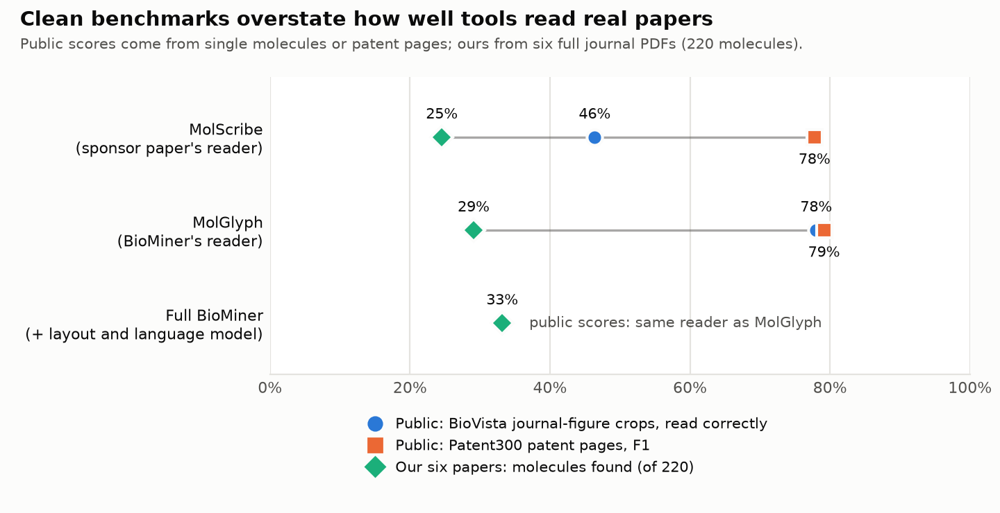

# 1.4 Sponsor check-in: benchmark findings (draft)

XN Project Group 1 · for Dr. Anton Sinitskiy · draft of 2026-10-13

**Status:** a working draft of the check-in material (#20). The revised 1.4 assignment isn't on Canvas yet. When it is, reshape this to its required format and sections. Rows marked *pending* are teammates' benchmarks that haven't been committed yet. Every number here is regenerated from the repo by `benchmarks/aggregate.py` ([full tables](../../benchmarks/results/comparison.md)).

## What we tested

We test each tool on the job you described: given a journal PDF, list the SMILES of every molecule drawn in it. Scoring is exact match of canonical SMILES (RDKit) against the hand-checked answer key for six internal papers (220 molecules). Precision is the share of output SMILES that are correct; recall is the share of the paper's molecules found.

- **Finding molecules on a page:** MolDetV2, the object detector BioMiner uses. *Pending: an OpenCV contour detector for comparison (Peter).*
- **Reading each drawing into SMILES:** MolScribe (the reader in your paper's pipeline) and MolGlyph (BioMiner's reader, trained on journal figures). *Pending: MolSight (Jin); MolGrapher, DECIMER and DeepSeek-OCR-2 (Bijay).*
- **A complete system:** BioMiner, which adds page-layout analysis and a 32-billion-parameter vision-language model. The model links drawings to compound labels and expands scaffold-plus-R-group tables into full molecules. It ran on one university GPU in 20 minutes for all six papers, with no API cost.

## Main finding: clean benchmarks overstate real-paper performance

| System | Public: journal-figure crops (BioVista) | Public: patent pages (Patent300, F1) | Our six papers: found / 220 | Our six papers: precision |
|---|---|---|---|---|
| MolScribe | 46% | 78% | 54 (25%) | 31% |
| MolGlyph | 78% | 79% | 64 (29%) | 39% |
| Full BioMiner | same reader as MolGlyph | | **73 (33%)** | **68%** |

A tool that reads 78% of benchmark drawings finds fewer than a third of the molecules in real papers. For reference, the pipeline in your paper (Docling figures, a molecule gate, MolScribe, run by Claude Code) found 13 of the 220.

## Where molecules are lost

| Paper | Molecules | MolScribe | MolGlyph | Full BioMiner | What the paper tests |
|---|---|---|---|---|---|
| 1 | 17 | 17 | 17 | 17 | single drawn drugs |
| 2 | 34 | 8 | 10 | 9 | scaffold + table of substituents drawn as structures |
| 4 | 60 | 11 | 14 | 23 | PROTAC series: scaffold + R-group tables |
| 6 | 1 | 0 | 0 | 0 | one molecule; missed by every tool |
| 16 | 4 | 1 | 2 | 1 | macrocycles (BioMiner's 1 vs MolGlyph's 2 is run-to-run GPU noise) |
| 19 | 104 | 17 | 21 | 23 | scaffold + R-group tables written as text |

- **Finding the drawings is mostly solved.** On 300 patent pages MolDetV2 boxes 99.4% of the molecules. The losses come after detection.
- **R-group tables are the main gap.** Papers 2, 4 and 19 hold 198 of the 220 molecules. Most of those are drawn as one scaffold plus a table of substituents, so no single drawing contains the full molecule. BioMiner's language model expands some tables: 10 of its 23 molecules on paper 4, and 3 on paper 19, come from expanded tables. It still finds only 26% of paper 2 and 22% of paper 19.
- **The language model mostly removes junk.** BioMiner outputs 108 SMILES against about 165 for the reader alone, and finds more molecules. That is where its precision gain (39% to 68%) comes from.
- **Typical reading errors:** label text read as extra atoms, single substituent cells read as stand-alone molecules (paper 2), and (for MolScribe) R-group attachment points read as carbons.

## What we plan for Phase 2

Your suggestion from 10/06: read the PDF's text layer and the page image in parallel. The R-group stage is our first target (#74). Paper 19's tables are plain text in the PDF, while paper 2's table is drawn, so the stage needs both routes. BioMiner's table expansion (13 correct out of 25 generated) is the baseline to beat. The other modules are front end and detection, reading with voting across readers, and linking labels like `12a` to drawings.

## Questions for you

1. **Scoring.** Is exact match the right headline, or should a molecule count if it differs only in stereochemistry or tautomer form? Paper 2's key lists one benzimidazole twice, once as each tautomer.
2. **Salts.** Paper 4's compound 18 is recorded as an HCl salt. Should salts and counter-ions be kept or stripped?
3. **Precision or recall.** For your use, is 68% precision at 33% recall useful, or does output need to be near-certain even if fewer molecules are found?
4. **Labels.** Should the output pair each SMILES with its compound label (`12a`) and, later, its activity values? BioMiner does this, and scoring it would change our evaluation.
5. **Representativeness.** Do R-group tables dominate the literature you care about, as they do in papers 2, 4 and 19? Are more of the intended 20 papers available with answer keys?
6. **Building on BioMiner.** BioMiner's code is MIT-licensed, but some model weights are non-commercial (MolDetV2) or unlicensed (BioMiner-Instruct). Is building Phase 2 on top of it fine for your purposes?

## Sources

- Gulluoglu, H. S. A., et al. (2026). *Practical use of advanced AI frameworks on real-life scientific problems: Three case studies* [Preprint]. bioRxiv. https://doi.org/10.64898/2026.06.23.734132 (the sponsor paper; its OCSR section)
- BioMiner and the BioVista benchmark: https://github.com/jiaxianyan/BioMiner, arXiv:2604.21508
- MolMole Patent300 (LG AI Research, 2025): https://huggingface.co/datasets/doxa-friend/MolMole_Patent300
- Our benchmarks: `benchmarks/willdaly/README.md` and `benchmarks/results/comparison.md` in this repo

## AI disclosure

AI tool used: Claude (Claude Code). Purpose: running the benchmarks, building the comparison tables and figure, and drafting this summary. Specific contribution: Claude wrote the aggregation and figure scripts and drafted the text from the scored runs in this repo. Every number traces to a committed run folder. The group reviews and edits the text before it goes to the sponsor.
